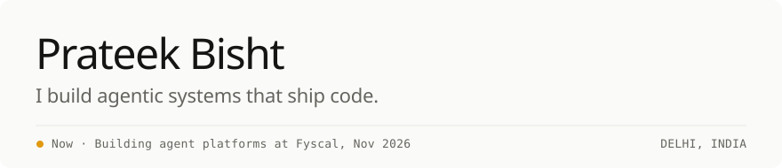

<picture>
  <source media="(prefers-color-scheme: dark)" srcset="assets/header-dark.svg">
  
</picture>

I'm a software engineer at [Fyscal](https://fyscaltech.com), building **OneXO**: a multi-tenant platform where
Claude Code, Codex or OpenCode turn a requirement into a reviewed pull request, each agent in its own sandbox.
The backends underneath are Go and TypeScript.

- One LLM gateway for every model call, with budgets, routing, fallbacks, guardrails and audit logs.
- 30+ Go APIs serving ~8M requests a month, traced end to end.
- Cross-service latency from 20+ ms to under 2 ms by moving core services from REST to gRPC.

The day job ships on Bitbucket, out of frame. What's here is what I build on my own time.

### Selected work

| Project | What it does | Built with |
| --- | --- | --- |
| [claude-code-microVM](https://github.com/prateekbisht23/claude-code-microVM) | Every chat gets its own Claude Code agent in a KVM microVM that boots in ~0.3 s. State lives on per-chat S3 volumes, so idle VMs die without losing work. | Bun · TypeScript · KVM · EC2 · S3 |
| [site-auditor](https://github.com/prateekbisht23/site-auditor) | Audits a site like a QA engineer and a frontend dev together: 5 subagents on 3 isolated browsers, findings re-verified and mapped to WCAG and Core Web Vitals. Read-only by design. | Claude Code plugin · Chrome DevTools MCP |
| [export-runner](https://github.com/prateekbisht23/export-runner) | Parallel FFmpeg export: keyframe-split segments, per-segment retries, resumable jobs and idempotent billing. | Go · FFmpeg |
| [webview](https://github.com/prateekbisht23/webview) | Turns any mix of files, URLs, text and images into one self-contained, offline HTML page. | Claude Code plugin · Agent Skill |
| [plan-out](https://github.com/prateekbisht23/plan-out) | Keeps multi-session AI planning consistent: small spec modules, a decision log, and a checker for broken links and stale decisions. | Claude Code skill · Python |
| [code-focus](https://github.com/prateekbisht23/code-focus) | VS Code extension that maps a file's dependencies and dependents. 40+ Marketplace installs. | TypeScript · VS Code API |
| [CloudPad](https://github.com/prateekbisht23/CloudPad) | Cross-device text and file sync in under 50 ms. | Django · Supabase · Yjs |

### Open source

- [supabase/supabase#38675](https://github.com/supabase/supabase/pull/38675) — import-data guide updated for the new dashboard UI
- [freeCodeCamp/freeCodeCamp#62312](https://github.com/freeCodeCamp/freeCodeCamp/pull/62312) — curriculum user-story fix
- [airbnb/javascript#3153](https://github.com/airbnb/javascript/pull/3153) — ESLint `--ext` note for `.jsx` files
- [legions-developer/invoicely#56](https://github.com/legions-developer/invoicely/pull/56), [#50](https://github.com/legions-developer/invoicely/pull/50) — invoice status default, light-mode badge fix

### Stack

Go · TypeScript · Python · gRPC · AWS (EC2, S3, SQS) · Terraform · KVM · Docker · OpenTelemetry · Grafana · Claude Code · MCP

---

[prateek.bishh.dev](https://prateek.bishh.dev) ·
[prateekbisht04@gmail.com](mailto:prateekbisht04@gmail.com) ·
[LinkedIn](https://www.linkedin.com/in/prateekbisht23/) ·
[X](https://x.com/Prateek_Bisht23) ·
[Book a call](https://cal.com/prateek.bisht/15min) ·
[Instagram](https://www.instagram.com/__prateek.23_/) ·
[Buy me a coffee](https://buymeacoffee.com/prateekbisht)
